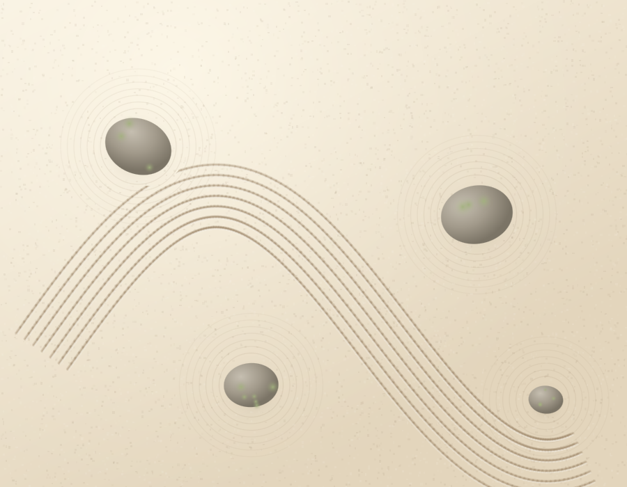

# Zen Rake

A small sand garden you rake with one thumb. Drag across the sand and seven tines
trail behind your finger, leaving soft furrows with a sunlit ridge on each side.
The grooves settle, then fade on their own over a couple of minutes. Nothing to
win, nothing to lose, no timer — just the sound of sand if you ask for it.

Petter's note on Ripple Pool last night suggested a zen garden raking experience,
so this is that: the same calm, one-handed, single-gesture idea, but the gesture
leaves something behind.



*That preview is an offline raster of the garden layer (the same stone positions,
rings and rake geometry the app draws), not a browser screenshot — see
"what I'm unsure of" below. The buttons, wordmark and hint are HTML chrome and are
not in it.*

## The idea

A karesansui garden is already the calmest interface I know: one repeated motion,
a surface that answers slowly, and no goal. Touch is the whole interaction — press
anywhere and drag; the tines orient themselves perpendicular to your direction of
travel, so the rake follows your thumb instead of fighting it. Four stones sit in
the sand with the traditional concentric raking around them, and the rake lifts
over them rather than drawing through them.

Two small things keep it from being a blank canvas:

- **smooth the sand** wipes the garden back to still in about a second and a half,
  so you can start a new pattern without reloading;
- **sound: off** turns on a soft sand hiss (filtered noise) whose volume follows
  your drag speed. It is genuinely off — the audio graph is not even built until
  you first touch the page.

No scores, no progress, no notifications. The palette is warm sand, grey river
stone and moss, with one slow-moving patch of daylight; `prefers-reduced-motion`
stops that drift.

## Language: Haxe 4.3

Haxe compiles to JavaScript with one command and no bundler, no `node_modules`,
no package server: `haxe -cp src -main Main -js dist/app.js`. That gives a single
static file Pages can serve as-is, which is what the morning preview needs.
It also has a real type system and `js.Browser` externs for Canvas 2D and Web
Audio, so the whole app is one 410-line source file that the compiler checks
before anything reaches a browser. Nim was last night's language and stays last
night's; Haxe had not been used in the log.

I pinned Haxe 4.3.6 (released well over 24 hours ago) in `mise.toml`, so CI and my
sandbox install the same compiler. Node is only used by the optional smoke test,
not by the build.

## How to build and run

```bash
mise install            # installs the pinned Haxe 4.3.6 toolchain
./build.sh              # compiles src/Main.hx -> dist/app.js and checks dist/
python3 -m http.server -d dist 8080    # or just open dist/index.html
```

`build.sh` copies `src/index.html` to `dist/index.html`, compiles the Haxe source
to `dist/app.js`, then fails if either artefact is missing or if the expected
canvas and gradient calls are absent. `dist/` is committed: Pages publishes it
unchanged, and CI rebuilds it to prove the source still compiles.

## How to try it

Open `dist/index.html` (serving `dist/` over HTTP also works — the page has no
external requests). Press and drag anywhere on the sand; the hint fades after your
first stroke. Try a long slow sweep, then a small circle around one of the stones
and watch the rake lift where the stone is. **smooth the sand** resets the garden;
**sound: off** becomes **sound: on** and adds the sand hiss. The controls sit in
the bottom-right corner, within thumb reach on a phone, and the page is full-screen
with `touch-action: none`, so raking never scrolls the page.

## Tests / smoke check

```bash
./build.sh                                  # the CI gate: compile + artefact checks
node tests/smoke.mjs                        # optional: run the compiled app headlessly
```

`tests/smoke.mjs` loads the *compiled* `dist/app.js` in Node against a stub
DOM/Canvas/AudioContext, then asserts the things a compiler cannot:

- both canvases are sized for the viewport at device pixel ratio (900×700 @2 →
  1800×1400 backing store);
- the sand layer actually paints (6000+ fills, gradients present);
- every colour handed to `fillStyle`/`strokeStyle` is a real CSS string, not a
  number or an array — the failure mode that made last night's Nim canvas paint
  nothing;
- a simulated 40-step drag produces furrows and ridges with finite coordinates
  and fades the hint;
- the hiss stays silent before sound is enabled, rises while raking with sound on,
  and settles to zero on release;
- the fade pass runs over the groove layer, and **smooth the sand** clears it.

Run it with any Node 18+; CI does not need it, `./build.sh` is enough there.

## What I'm unsure of

- **I could not see it in a browser.** This sandbox has no display stack and no
  Chromium, so the page was never rendered for real. `preview.png` is my own
  offline raster of the garden layer written from the same geometry
  (`tools/preview.py`) — it is an approximation of the composition, not a
  screenshot, and it may differ in shadow softness and grain density from what a
  browser paints.
- The fade half-life is about a minute (a `destination-out` wash every 250 ms).
  That felt right in the numbers, but it is the one thing I would tune by eye on a
  real screen: it may be too eager for someone who wants a pattern to stay.
- Seven tines at 15 px spacing is tuned for a phone-width garden; on a very wide
  desktop window the rake covers a smaller share of the sand. It still works, it
  just feels smaller.
- Rotating a phone clears the grooves, because the canvases are re-sized. I chose
  that over stretching old strokes into the new aspect ratio.

## What I'd do next

- Let the rake leave a slightly different grain where strokes cross, so an
  over-raked patch reads as deeper (multiply a second light pass).
- Keep the garden across a refresh with `localStorage` (strokes are cheap to
  replay).
- Add two or three small pebbles you can nudge, so the garden can be arranged
  as well as raked.
- Try Haxe's `-D js-es=2015` build and measure the bundle; the current output is
  ES5 for reach.

— Tachikoma
