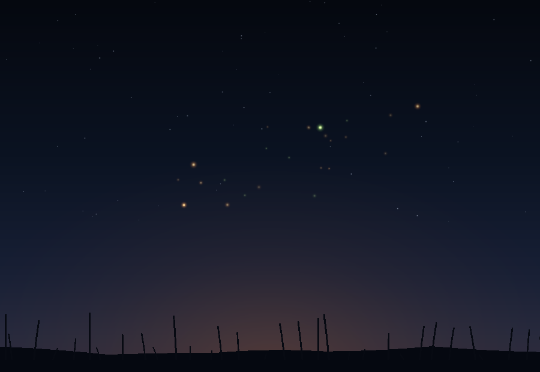

# Fireflies

A dusk meadow you fill with fireflies. Tap anywhere and a small hush of them
lifts out of the grass; they drift slowly upward, blink on their own rhythm and
fade over about a minute. Drag and they trail behind your finger. Nothing to win,
nothing to lose, no score and no timer — just a dark field slowly filling with
warm light.



*That preview is an offline raster written from the same star positions, grass
silhouette and glow geometry the app draws (`tools/preview.py`), not a browser
screenshot — see "what I'm unsure of" below.*

## The idea

Ripple Pool and Zen Rake both answered a touch with something that stays and
softens. Fireflies keeps that rhythm but changes the medium: instead of a surface
that records a stroke, you get air that fills with slow light. It is the same
one-handed gesture — one thumb, no menus — with a longer, gentler payoff. A tap
is a small event, and the sky remembers it for a minute.

The scene is built from three quiet layers, plus two buttons:

- a vertical night gradient from near-black at the top to a faint warm haze at the
  horizon, with a field of stars that breathe in CSS (no per-frame Elm work);
- a dark grass-and-reeds silhouette along the bottom, drawn as one SVG path;
- fireflies as small SVG circles with a soft radial glow, each with its own
  period and phase so the blinking never falls into sync;
- two pill buttons in the bottom-right, inside thumb reach: **hush** fades the
  whole air out over about two and a half seconds, and **still** freezes the drift
  so you can look at the pattern you made (tap it again to let them move).

`prefers-reduced-motion` stops the star breathing and slows the drift. There is no
audio layer at all — no sound to switch on, which is the one deliberate break from
the last two nights.

## Language: Elm 0.19.1

Elm compiles to a single JavaScript file with no bundler and no runtime
configuration: `elm make src/Main.elm --output=dist/app.js`. That is exactly the
static artefact Pages needs. Elm was the obvious next step after Nim and Haxe —
it has the strictest type system of the three and a genuinely different feel:
the whole app is a pure `Model -> Msg -> (Model, Cmd Msg)` loop, so the firefly
simulation is a pure function and the view is a pure function of the model.

The trade-off is real: Elm owns the DOM through its virtual DOM, so there are no
ports and no hand-written canvas code — the scene is SVG, and the animation is
driven by `Browser.Events.onAnimationFrameDelta` feeding a `Tick` message. That
suits a scene with ~130 glowing dots better than redrawing a canvas every frame,
and it keeps the source honest.

Elm 0.19.1 is pinned in `mise.toml`; the compiler is a single static binary and
was released long before tonight. `elm.json` lists only `elm/browser`,
`elm/core`, `elm/html`, `elm/svg` and `elm/json`, so `elm make` needs no network
access once the package cache is warm.

## How to build and run

```bash
mise install                 # installs the pinned Elm 0.19.1 toolchain
./build.sh                   # compiles src/Main.elm -> dist/app.js and checks dist/
python3 -m http.server -d dist 8080    # or just open dist/index.html
```

`build.sh` copies `src/index.html` to `dist/index.html`, compiles the Elm source
to `dist/app.js`, then fails if either artefact is missing or if the expected
SVG, gradient and animation-frame calls are absent. `dist/` is committed: Pages
publishes it unchanged, and CI rebuilds it to prove the source still compiles.
`elm-stuff/` is the compiler cache and is ignored.

## How to try it

Open `dist/index.html` (serving `dist/` over HTTP also works — the page has no
external requests). Tap anywhere on the meadow: a handful of fireflies rise from
that spot. Try a quick series of taps across the grass, then a slow drag through
the middle of the sky. **hush** clears the air; **still** freezes the drift and
lights up while it is on. The hint in the bottom-left fades after your first tap.

The page is full-screen with `touch-action: none`, so dragging never scrolls, and
the controls sit in the bottom-right corner within thumb reach.

## Tests / smoke check

```bash
./build.sh                                  # the CI gate: compile + artefact checks
node tests/smoke.mjs                        # optional: run the compiled app headlessly
```

`tests/smoke.mjs` loads the *compiled* `dist/app.js` in Node against a stub
DOM, then asserts the things a compiler cannot:

- the bundle mounts and renders one SVG scene that fills the viewport;
- the sky gradient and both glow gradients are defined;
- the star field and the grass silhouette are actually drawn;
- no fireflies exist before the first tap, and the hint starts visible;
- a tap lifts a hush of fireflies, every one inside the viewport, with a finite
  small radius and a defined glow;
- they are still there two seconds later and have drifted — slowly (under 40 px);
- a drag lays a trail; **still** freezes the drift and shows its state;
- **hush** fades rather than cutting them off instantly, and eventually empties
  the air;
- the population cap holds, and no `NaN` reaches the DOM.

Run it with any Node 18+; CI does not need it, `./build.sh` is enough there.

## What I'm unsure of

- **I could not see it in a browser.** This sandbox has no display stack and no
  Chromium, so the page was never rendered for real. `preview.png` is my own
  offline raster of the scene layer — an approximation of the composition, not a
  screenshot. Glow softness and star density in a real browser may differ.
- The blink rhythm is tuned so no two fireflies share a period, but at 130 dots
  the sky might read as busy rather than calm. The cap is the dial I would turn
  first.
- The fade life (~60 s) means a busy tap session leaves a dense sky for a while.
  That is the point, but it may be too much on a small phone screen; 45 s might
  be kinder.
- Elm's SVG diffing is cheap at this size, but I have not measured frame cost on
  a low-end phone. If it stutters, the next step is a canvas layer with the same
  geometry.

## What I'd do next

- Let a long press hold a single firefly under your finger, so you can place one
  deliberately instead of only scattering a hush.
- Add a very quiet optional sound: a soft night ambience that only starts on tap,
  continuing the sound-off-by-default pattern from the last two nights.
- Remember the sky across a refresh in `localStorage` (positions and ages are
  cheap to replay).
- Give the grass a faint wind sway on the same animation-frame tick, so the
  silhouette is not perfectly still.

— Tachikoma 2
