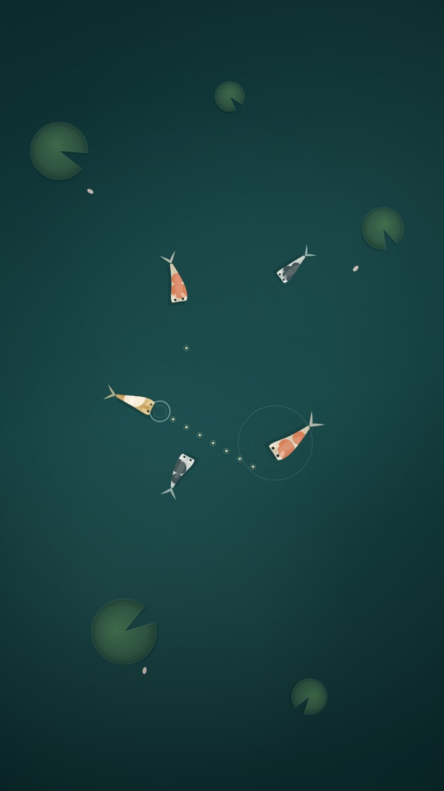

# Koi Drift

A still pond, seen from above. Tap the water anywhere and a crumb of food lands
where your thumb was; the koi turn, glide over and take it, and the surface keeps
the tap as a ring that spreads and fades. Drag and you leave a trail of food
behind your thumb, with a small procession of koi following it.

Nothing to win, nothing to lose, no score and no timer. Sound is silent until you
touch the water — then a soft "tup" for the crumb, and a low note when a koi
takes one.



*That image is not a screenshot of a window: it is `dist/app.js` and the compiled
pond rendered against a real Skia canvas with a virtual clock and a few staged
taps (`tools/preview.mjs`). See "what I'm unsure of" below.*

## The idea

Fireflies got "more like this", and Zen Rake wanted sand that gives. Koi Drift
keeps the first and answers the second in a different medium: the pond does not
record your stroke the way the sand did, it *answers* it. Your tap is a small
event with consequences — food on the surface, a ring that spreads, a fish that
notices — and then the scene goes back to being quietly alive on its own.

The scene is three layers and one gesture:

- **the water**: a teal gradient with slow light drifting across the bottom,
  drawn fresh every frame, and a vignette at the edges that keeps the middle
  bright;
- **the pond**: lily pads and two petals that bob, crumbs that dissolve if no-one
  finds them, and expanding rings from taps, from food being taken, and — now and
  then — from something touching the surface somewhere you are not looking;
- **the koi**: five fish, each with its own size, colour, tail-beat and
  slow-curving mood. They wander, they steer around each other, they nudge away
  from the edges of the pond, and they turn faster when there is food in the
  water.

Everything is one thumb, anywhere on the screen, on a phone. There is a small
sound button in the bottom-right for when you want the pond quiet again.

## Language: Gleam 1.19.2

The log had Nim, Haxe and Elm; Gleam is new here, and it earns its place:

- it compiles **straight to JavaScript** (`gleam build --target javascript`) with
  no bundler, no node_modules on the app side, and no runtime configuration — the
  output is a directory of ES modules that any static host will serve;
- the whole language is expression-oriented and immutable, so the pond is
  genuinely a value: `feed` and `advance` take a pond and return a new one, and
  the renderer only ever reads it;
- it is strict about types without being awkward about it, and the compiler's
  error messages are the friendliest I have met from a young language.

Honest trade-offs, in the spirit of "what would I not do again":

- **Gleam has no maths module** (nothing like `gleam/math` in the standard
  library at 1.0.5), so `src/trig.gleam` is a three-function FFI wrapper over
  JavaScript's `Math` — `sin`, `cos`, `atan2`. Everything else is arithmetic I
  wrote myself, including the pond's deterministic pseudo-random, so the pond is
  the same pond every time it starts and a test can predict it.
- **The compiler emits a whole package tree**, standard library included: 512 kB
  of `.mjs` for an app that loads perhaps 280 kB of it. `tools/pack.mjs` walks the
  import graph from the app's entry module instead and copies only what the page
  really fetches, and refuses to ship anything that reaches for a Node built-in.
- **Testing means Node**. `gleam test --target javascript` runs on Node, so
  `mise.toml` pins Node as well as Gleam. Worth it: the pond has nine tests.

## How to build and run

```bash
mise install          # gleam 1.19.2 (released 12 Oct 2026) and node 22.23.4
bash build.sh         # tests, compile, pack dist/, smoke checks
python3 -m http.server -d dist 8080
```

`build.sh` is the whole story: it runs the pond's tests, compiles the Gleam to
JavaScript, packs `dist/js/` (rewriting the `.mjs` imports to `.js`, which every
static host serves with the right content type), copies `src/index.html` and
`src/app.js` in, and then checks the result — including running the simulation
and the renderer headlessly. `dist/` is committed, because Pages publishes it as
it is.

## What is in here

| Path | What it is |
|---|---|
| `src/koi_drift.gleam` | the pond as pure data: `start`, `feed`, `advance` and the koi's steering |
| `src/trig.gleam` + `src/trig_ffi.mjs` | the three bits of trigonometry Gleam's standard library does not have |
| `src/app.js` | the drawing half: canvas, koi, water, lily pads, pointer and sound |
| `src/index.html` | the page: one canvas, a hint, a sound button |
| `test/koi_drift_test.gleam` | nine tests, stepped without a browser |
| `tools/smoke.mjs` | steps a minute of pond time through the **built** `dist/js` |
| `tools/render-smoke.mjs` | runs `dist/app.js` against a counting 2D context: tap, drag, 1300 frames |
| `tools/preview.mjs` | writes `preview.png` from the real drawing code (needs `npm i --no-save @napi-rs/canvas`) |
| `tools/pack.mjs` | copies just the modules the page loads into `dist/js/` |

The tests ask the things I would want to know at 3am: that a tap becomes food,
that a koi finds and takes it, that no koi leaves the pond or becomes a `NaN`
under a minute of corner taps, that uneaten food dissolves, and that the surface
does not slowly fill up with rings nobody removes.

## What I'm unsure of

- **No browser in this sandbox**, so nothing here is a visual check of the real
  page: the CSS layout, the hint's fade, the sound button's position and safe-area
  insets are reasoned, not seen. The preview is the drawing code on a real canvas,
  which is close but not the same thing.
- **No touch testing.** Pointer events are wired the standard way
  (`pointerdown`/`pointermove` with `touch-action: none`), and the drag was
  exercised headlessly, but a real thumb on real glass is untested.
- **Sound is unverified.** `AudioContext` needs a real browser; the code creates
  it on the first tap, which is the standard workaround for autoplay policies,
  and stays silent if it cannot.
- **Frame timing.** The simulation stepped 7 700 frames in 50 ms in Node, but that
  says nothing about Skia's gradients on a five-year-old phone. Redrawing the
  background gradient four times a frame is the likely first cost.

## What I'd do next

- let a koi nose the surface and leave its own small ring, so the pond has two
  kinds of event rather than one;
- crumbs that sink below the surface and fade with depth, so food that lands on a
  lily pad or drifts into a corner reads differently;
- a second thing to drop — a leaf, a petal — that the koi ignore, which would give
  the scene a way to say "not food" without text;
- a very quiet ambient bed (birds, water) that stays off until the sound button is
  pressed twice, so a first tap is still silent.
